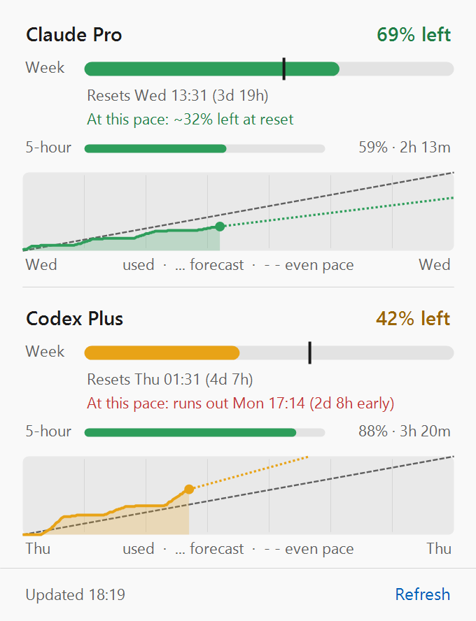

# AI Usage Tray

A Windows tray icon that shows how much of your **Claude** (Pro/Max), **Codex** (ChatGPT Plus/Pro) and **GitHub Copilot** usage limits you have left, and whether it will last until the reset. Claude and Codex have weekly limits; Copilot has a monthly allowance of premium requests.

<p align="center">
  <picture>
    <source media="(prefers-color-scheme: dark)" srcset="docs/panel-dark.png">
    
  </picture>
  <br>
  <sub>The popup panel (demo data). Claude is on track; Codex is projected to run out before its reset.</sub>
</p>

-  **Icon**: one split icon. The top half is the first service (Claude by default) and the bottom half the second (Codex). Each half shows the % of the weekly (or monthly) limit left, colored green (>50%), amber (20–50%), red (<20%) or gray (can't update). With one service, it fills the whole icon.
- **Hover**: a short summary with reset countdowns, the 5-hour window and the forecast.
- **Click**: a popup panel with bars, a pace marker, a forecast ("At this pace: ~86% left at reset" / "runs out Tue 09:58") and a chart of the current week (or month). It lists every service, including a third one that doesn't fit on the icon.
- **Right-click**: full details, links to each service's usage page, refresh, *Color by forecast*, *Services*, *Start with Windows*, and quit.
- **Notifications**: when usage drops to 50/25/10% left, when the forecast says you'll run out before the reset, when a 5-hour window is almost used up, and when the limit resets.

## Requirements

- Windows 10/11, with Windows PowerShell 5.1 (built in). Nothing to install.
One or more of:

- **Claude Code** signed in with a Claude subscription (it creates `%USERPROFILE%\.claude\.credentials.json`).
- **Codex CLI** signed in with ChatGPT (it creates `%USERPROFILE%\.codex\auth.json`).
- **GitHub Copilot** signed in from a JetBrains (or Vim/Neovim) plugin, which creates `%LOCALAPPDATA%\github-copilot\apps.json`, or the **GitHub CLI** (`gh auth login`). VS Code and the Copilot CLI keep their login in Windows Credential Manager, which the app doesn't read.

The app shows the services it finds a login for. To choose yourself, see [Choosing services](#choosing-services).

## Build and run

The `.exe` is a tiny host that runs `AiUsageTray.ps1`. With it, Windows lists the tray icon as "AI Usage Tray" and remembers its pin. Build it with the C# compiler that ships with Windows:

```powershell
# app icon (optional, already in src/)
powershell -NoProfile -ExecutionPolicy Bypass -File .\AiUsageTray.ps1 -MakeIco .\src\AiUsageTray.ico

# compile
& "$env:SystemRoot\Microsoft.NET\Framework64\v4.0.30319\csc.exe" /nologo /target:winexe /optimize `
  /out:AiUsageTray.exe /win32icon:src\AiUsageTray.ico `
  "/r:$([PSObject].Assembly.Location)" /r:System.Windows.Forms.dll src\AiUsageTray.cs
```

Then run `AiUsageTray.exe`. Keep it next to `AiUsageTray.ps1`, because the exe loads the script from its own folder. Right-click the icon and select **Start with Windows** to launch it at login. If Windows hides the icon under **^**, drag it onto the taskbar once.

Without the exe, you can run the script directly. The icon then shows up as "Windows PowerShell":

```powershell
powershell -NoProfile -STA -ExecutionPolicy Bypass -File .\AiUsageTray.ps1
```

## How it works

Every 5 minutes it asks each service for your current usage, using the login the CLI already stored:

| | Endpoint | Login file |
|---|---|---|
| Claude | `https://api.anthropic.com/api/oauth/usage` | `~/.claude/.credentials.json` |
| Codex | `https://chatgpt.com/backend-api/wham/usage` | `~/.codex/auth.json` |
| Copilot | `https://api.github.com/copilot_internal/user` | `%LOCALAPPDATA%\github-copilot\apps.json` (or `hosts.json`), else `gh auth token` |

These are the same endpoints that `/usage` in Claude Code, `/status` in Codex and the Copilot editor plugins use. Your tokens are only sent to the company that issued them. For Copilot, the app shows **premium requests** (chat and completions are unlimited on paid plans). That quota resets on the 1st of each month (UTC).

**The app only reads your login files and never changes them.** It does not renew tokens, so it can't sign the CLIs out. The CLIs renew their logins when you use them. If you haven't used one for a while, its half goes gray with "Login expired - open Claude Code" (or Codex). Run the CLI once and it recovers on the next refresh.

The **forecast** assumes the rest of the window goes like the window so far (average rate since it started). For the first 12 hours of a week (about 2 days of a month) it says "too early".

## Files

Everything is stored under `%LOCALAPPDATA%\AiUsageTray\`:

| File | What |
|---|---|
| `config.json` | optional: which services to show, refresh interval, alert levels (see below) |
| `state.json` | settings (color mode) and which alerts already fired |
| `history.csv` | one row per refresh, for the chart. Kept for 40 days |
| `app.log` | errors and recoveries. Rotates at 256 KB |
| `host.log` | only if the exe itself fails to start the script |

## Choosing services

By default the app shows every service that has a login on this machine, in the order Claude, Codex, Copilot. If there are three, the first two go on the icon and all three are in the panel, tooltip and menu.

To choose yourself, right-click the icon and open **Services**. Ticking or unticking a service saves your choice to `config.json`; **Automatic** goes back to detecting logins. To change the order (which two go on the icon, top first), choose **Edit config.json...** and edit the `services` list:

```json
{
  "services": ["copilot", "codex"],
  "refreshMinutes": 5,
  "alertThresholds": [50, 25, 10],
  "fiveHourAlertAt": 10
}
```

Every key is optional. Leave out `services` to keep auto-detection. The file lives in `%LOCALAPPDATA%\AiUsageTray\`, so each machine has its own. Changes apply at the next refresh (click **Refresh** to apply them now). If the file isn't valid JSON, the app uses the defaults and writes the error to `app.log`.

## Settings

The defaults (refresh interval, alert thresholds, the 5-hour alert level) and the colors are at the top of `AiUsageTray.ps1`. `config.json` overrides the defaults.

## Limitations

- **The usage endpoints are not public APIs.** They can change without notice. If one does, that half goes gray, and the reason shows in the panel and in `app.log`.
- **Claude's endpoint has a strict rate limit.** Normal polling is fine. If it does return HTTP 429, the app backs off for at least 10 minutes and keeps showing the last numbers.
- **The chart only has data from while the app was running.**
- **The panel opens correctly with the taskbar at the bottom or top of the screen.** Side taskbars aren't handled yet.
- **Two digits on the icon**: 100% left shows as 99.

## Development

`-Test` prints the current tooltip and menu text and saves icon and panel previews to `%TEMP%\AiUsageTray-preview`. It queries each endpoint once, so use it sparingly.

- `-Test -Demo` uses made-up numbers and history and makes no network calls. The screenshots in `docs/` come from `-Test -Demo -TestOut docs`.
- `-Test -DemoHistory` uses live numbers with a made-up chart history.
- `-Only copilot,codex` (with `-Test`) shows those services instead of the configured or detected ones. `-Test -Demo` uses Claude and Codex unless you pass `-Only`.

See `CLAUDE.md` for code structure notes.
